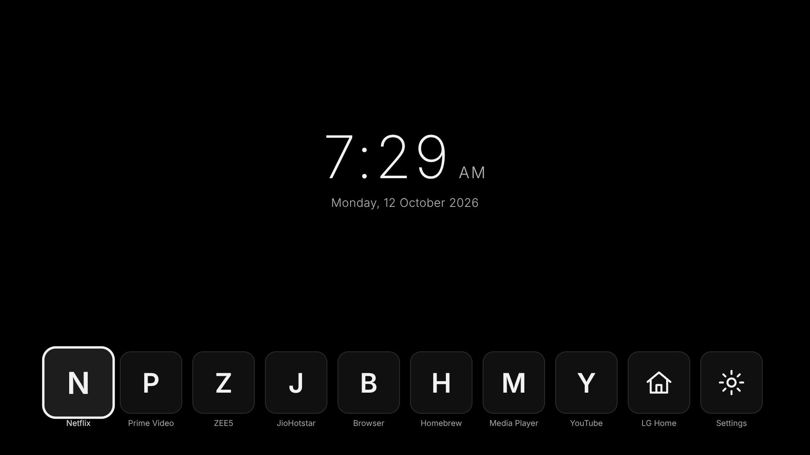
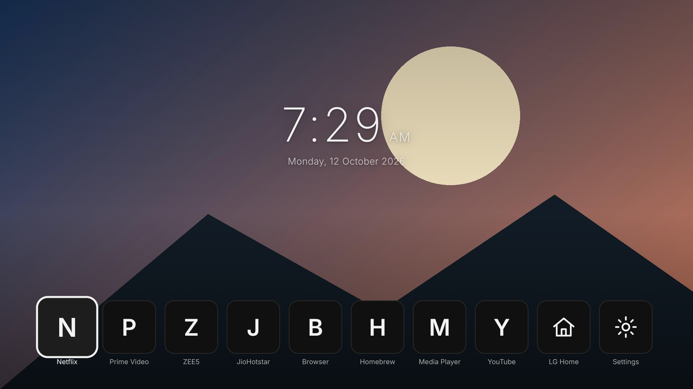
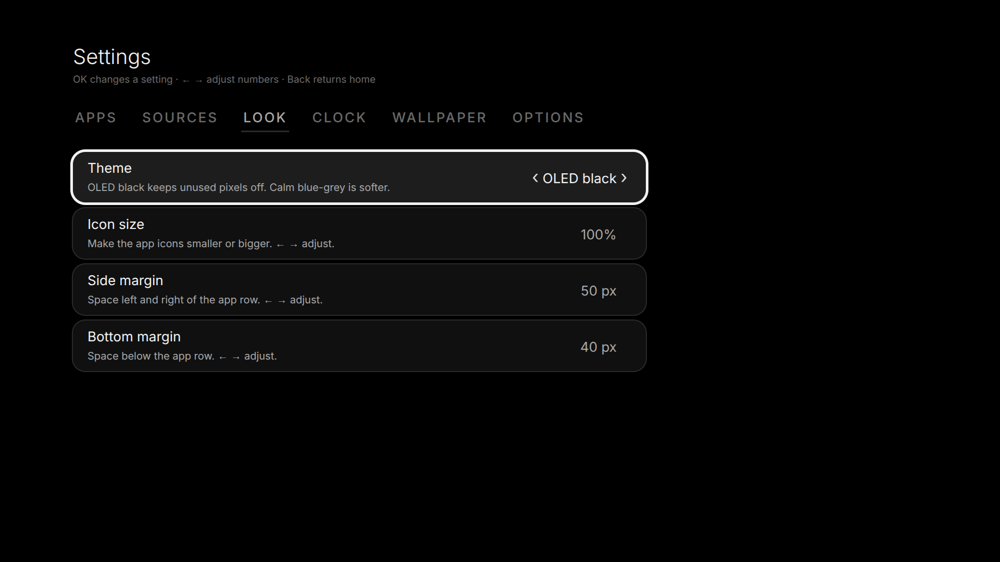
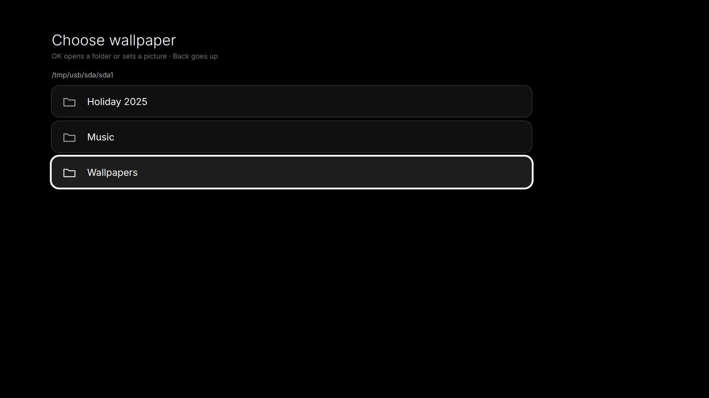

# Custom Home launcher for LG webOS TVs

A calm, minimal home screen as a normal webOS app: a centre clock, your apps in one row along the
bottom, and a background that can be plain **OLED black**, one picture, or a **slideshow from a
folder on a USB drive**. Everything is adjustable from the remote: theme, clock, icon size, margins.

> **Targeted at older webOS versions.** This launcher was built for, and tested on, an LG TV running **webOS 4.x** (older web view, about Chrome 53),
> where LG's own Home is slow and heavy. It is compiled for those old web views and avoids newer browser features, and its extras (wallpaper
> browsing, the live app list, the Home hand-over) rely on a **rooted TV with the Homebrew Channel**. Newer webOS versions may run it too, but
> they are untested, and some features (such as the "alternative method" home-app setting, which is for webOS 5 and newer) behave differently.

App ID: `tld.my.customlauncher`.

| | |
|---|---|
|  |  |
|  |  |

> **This project is a fork of [partridgeworks/webos-launcher](https://github.com/partridgeworks/webos-launcher)**
> (MIT licence, see `LICENSE`), which provided the app skeleton, the Luna service bridge, the app list and icon loading, and the
> remote-control handling. Thank you to its author. This fork adds a centre clock, OLED black and theme settings, a wallpaper picker with
> USB slideshow, adjustable clock, icon size and margins, faster start-up from caches, and an experimental option to open the launcher
> instead of LG Home. Please see the original project for the minimal launcher this grew from.

## Using it

| Where | Key | Does |
|---|---|---|
| Home | ← → | Move along the row |
| Home | OK | Open the app. The last two tiles are **LG Home** (LG's own home) and **Settings** |
| Settings | ← → on the tab bar | Apps · Sources · Look · Clock · Wallpaper · Options |
| Settings (apps) | OK / hold OK | Add or remove an app / re-order |
| Settings (other tabs) | OK, or ← → | OK steps through the choices; ← → nudge numbers (they stop at the ends) |
| Any | Back | Go back one screen (it does nothing on Home) |

### Settings

- **Apps / Sources:** which apps and HDMI inputs are in the row, and their order. By default every app the TV reports is shown.
- **Look:** theme (OLED black or calm blue-grey), icon size (70–140 %), side margin and bottom margin of the row.
- **Clock:** time format (12-hour with a small AM/PM, 24-hour, or the TV's setting), size, thickness, height and sideways position, colour, and whether to show the date and AM/PM.
- **Wallpaper:** see below. Also the slideshow speed and shuffle.
- **Options:** close LG Home on launch (frees memory), the live app list (Homebrew Channel), the LG Home hand-over and its boot link, **Close LG Home now**, and **Reset look and clock**.

### Wallpaper

**Settings → Wallpaper → Wallpaper** opens a folder browser:

- **Default background** is plain black (or the calm gradient, depending on the theme).
- Open **USB drive** (or **Internal storage**, `/media/developer`), then either
  - press OK on a picture to use it as the wallpaper, or
  - choose **Play this folder as a slideshow** to play every picture in the folder.

Use JPG, PNG, WebP or BMP, ideally around 1920×1080 to 3840×2160 and a few MB at most. A picture is
skipped if its file is over 8 MB or it is over 25 megapixels, and the message says which. The slideshow
pauses while the launcher is in the background.

**How it works.** A webOS web app cannot browse folders or open `file://` pictures. Browsing and
reading go through the Homebrew Channel's service, which runs a few fixed shell commands as root
(`ls`, `wc`, `dd`, `base64`). A picture is read in ~96 KB pieces, joined in memory and shown from there.
So wallpapers need a rooted TV with the Homebrew Channel, like the live app list.

## Install on the TV

Copy the `.ipk` to the TV and install it, from your PC:

```
scp -O tld.my.customlauncher_1.0.0_all.ipk root@TV_IP:/tmp/
ssh root@TV_IP
luna-send -i luna://com.webos.appInstallService/dev/install '{"id":"com.ares.defaultName","ipkUrl":"/tmp/tld.my.customlauncher_1.0.0_all.ipk","subscribe":true}'
luna-send -n 1 luna://com.webos.applicationManager/launch '{"id":"tld.my.customlauncher"}'
```

(Or use [webOS Dev Manager](https://github.com/webosbrew/dev-manager-desktop).) Installing over an older
version keeps your settings. To make the Home button open it, map the button to the app ID
`tld.my.customlauncher` with [LG Input Hook](https://github.com/Simon34545/lginputhook).

To remove it: uninstall "Home" from the Homebrew Channel or Dev Manager.

## Making it the TV's home app (experimental)

> **Experimental.** It may not work on webOS versions older than 5; on webOS 4 the TV did not follow the setting in testing.

**Settings → Options → Use as the TV's home app** sets the system setting `defaultApps.home` to this launcher, so the Home
button, and leaving an app with Back, open it instead of LG Home. It is off by default and changes a system setting, so:

- Try it: switch it on, open an app, and press Back or Home.
- **Before uninstalling the launcher, switch it off** (or the Home button has nothing to open). To undo it from a shell:
  ```
  luna-send -n 1 -f luna://com.webos.settingsservice/setSystemSettings '{"category":"general","settings":{"defaultApps":{"home":"com.webos.app.home"}}}'
  ```
- If you also use Input Hook for the Home button, this is an extra: Input Hook covers Home, this setting may also cover Back.

## Opening the launcher instead of LG Home (experimental, built for older webOS)

**Settings → Options → Open this launcher instead of LG Home** starts a small background helper that watches which app the TV reports as being
in front. When that becomes LG Home (Home, leaving an app with Back, boot) it opens the launcher instead. **Nothing is replaced or mounted.**

- **Start that helper at boot** is a separate switch: it adds or removes one link in the TV's startup folder, nothing else.
- The "LG Home" tile still opens LG's own Home (the helper stands down until you leave it).
- **Turn it off before uninstalling the launcher.** Reversal steps (also over SSH) and a diagnostics script are in [`src/homehook/README.md`](src/homehook/README.md).

## Speed and memory

- The app list and the last wallpaper are cached, so the launcher opens complete and then refreshes in the background.
- In the background it draws nothing and releases its pictures. webOS can still close any background app when memory is low;
  LG offers no way to prevent that. Closing LG Home (Options) frees memory and makes that less likely.

## Speed and memory

- **Fast start.** The app list and the wallpaper are cached, so the launcher draws its full screen immediately and refreshes in the background.
- **Light in the background.** When another app is in front, the launcher draws nothing and holds no wallpaper or tiles. webOS can still
  close a background app when the TV is short of memory (LG documents this and gives apps no way to prevent it), which is why a
  fast cold start matters, and why **Close LG Home when this opens** (Options) frees memory.
- Big photos are shrunk before showing; pictures around 1920x1080 load fastest.

## Troubleshooting

- **A picture won't show:** the message says why. Typical causes: file over 8 MB, over 25 megapixels, or not JPG/PNG.
- **"Can't read the storage":** the Homebrew Channel service isn't answering the app. Check it is installed and running.
- **USB drive missing in the picker:** plug it in, then open the picker again. The drive must be mounted by the TV.
- **Odd layout after changing sizes:** Settings → Options → **Reset look and clock**.

## Credits

- **[partridgeworks/webos-launcher](https://github.com/partridgeworks/webos-launcher)** (MIT): the project this is a fork of.
- **Built with Claude.** This fork was developed in conversation with [Claude](https://www.anthropic.com/claude), an AI assistant made by
  Anthropic, which wrote and tested most of the code. It was tried out and directed by the repository's maintainer on a real LG TV.
  (This is a credit, not an endorsement by Anthropic.)
- Bundled third-party material, with its licences, is listed in [THIRD_PARTY_NOTICES.md](THIRD_PARTY_NOTICES.md).

## Build

Needs Node 18+.

```
npm install
npm test           # unit tests for the settings and the picture loader
npm run build      # type-check, then build dist/ (compiled for old web views, Chrome 53+)
npm run package    # dist/ -> build/tld.my.customlauncher_<version>_all.ipk
```

`npm run dev` serves the UI in a desktop browser with sample apps and folders.

## Notes for developers

- The build targets Chrome 53 (webOS 4.x) and avoids CSS grid, `gap` and `inset`. Module scripts
  don't load from `file://` on webOS, so the bundle is one classic script.
- `src/lib/prefs.ts` describes every setting in one table; Settings lists and key handling come from it.
- `src/lib/wallpaper.ts` lists folders with `ls -1p` and reads pictures with `dd | base64` through the
  Homebrew Channel service; `src/components/Wallpaper.tsx` cross-fades two layers and releases the one that faded out.
- The row's icon size and margins are set on the row element, so the Settings grid keeps its own sizes.
