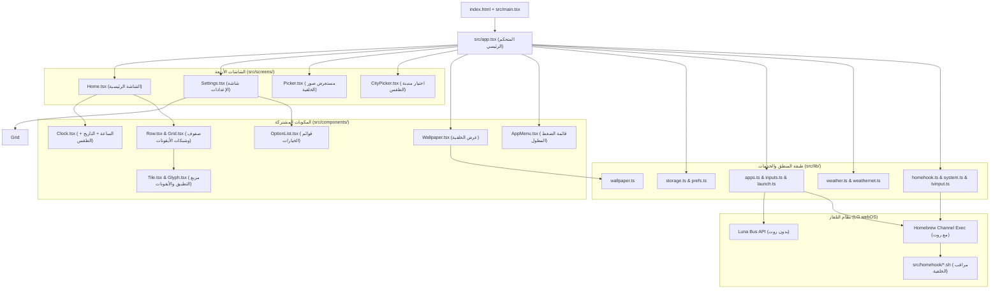

# دليل معمارية وهيكلة مشروع Init (webOS Custom Launcher)

هذا المستند يقدّم تحليلاً شاملاً ومفصّلاً لهيكلة مشروع **Init** (`dev.init.tv`)، ليكون مرجعاً عملياً سريعاً يسهّل عليك فهم الكود والتعديل عليه أو إضافة ميزات جديدة.

> [!TIP]
> تم حفظ نسخة دائمة من هذا الدليل داخل مشروعك في المسار: [`docs/ARCHITECTURE.md`](file:///home/houssem/code/webos-projects/Init/docs/ARCHITECTURE.md).

---

## 1. نظرة عامة والتقنيات المستخدمة (Tech Stack)

تطبيق **Init** هو شاشة رئيسية بديلة (Custom Home Screen / Launcher) لأجهزة تلفاز **LG webOS** (يدعم من webOS 4.x حتى أحدث الإصدارات).

* **إطار العمل (UI Framework):** Preact (بديل خفيف وسريع جداً لـ React بحجم ~3KB يناسب ذاكرة التلفاز المحدودة).
* **اللغة:** TypeScript.
* **أداة البناء (Bundler):** Vite (مضبوط لتوليد ملف جافاسكربت كلاسيكي واحد بصيغة `IIFE` متوافق مع محرك **Chrome 53** القديم الموجود في webOS 4).
* **التخزين:** `localStorage` لحفظ الإعدادات، ترتيب التطبيقات، كاش الطقس، وكاش الخلفية.
* **التواصل مع نظام التلفاز:**
  1. **Luna Service Bus (`window.webOS.service.request`):** واجهة LG الرسمية لفتح التطبيقات، قراءة مداخل HDMI، وقراءة إعدادات الوقت.
  2. **Homebrew Channel Root Exec (`luna://org.webosbrew.hbchannel.service/exec`):** لتنفيذ أوامر شل (Shell) بصلاحيات الروت (جلب قائمة التطبيقات الحية مع أيقوناتها، قراءة صور الخلفية من USB، إضافة اللانشر كمدخل TV، وتشغيل مراقب زر Home).

---

## 2. المخطط المعماري وتدفق البيانات (Architecture Diagram)



---

## 3. الهيكل الشجري الكامل للملفات ووظيفة كل ملف

### أ. ملفات الجذر والتكوين العام
| الملف | الوظيفة |
| :--- | :--- |
| [`package.json`](file:///home/houssem/code/webos-projects/Init/package.json) | تعريف اسم الحزمة (`init-launcher`)، الإصدار (`1.0.0`)، وسكربتات البناء والاختبار. |
| [`public/appinfo.json`](file:///home/houssem/code/webos-projects/Init/public/appinfo.json) | **ملف هوية تطبيق webOS الرسمي:** يحتوي على `id` (`dev.init.tv`)، الاسم (`Init`)، الأيقونات، الدقة (`1920x1080`)، وحد الذاكرة (`requiredMemory: 20`). |
| [`vite.config.ts`](file:///home/houssem/code/webos-projects/Init/vite.config.ts) | إعدادات المترجم Vite؛ يحوّل الكود ليتوافق مع `chrome53` ويزيل `type="module"` لأن webOS يرفض تحميل ES Modules من `file://`. |
| [`index.html`](file:///home/houssem/code/webos-projects/Init/index.html) | صفحة HTML الأساسية بأبعاد `1920x1080` وخلفية سوداء `#000` لمنع الوميض الأبيض عند الإقلاع. |

---

### ب. إعدادات وثوابت التطبيق (`src/config/`)
| الملف | الوظيفة |
| :--- | :--- |
| [`constants.ts`](file:///home/houssem/code/webos-projects/Init/src/config/constants.ts) | يحتوي على معرّف التطبيق `APP_ID`، روابط خدمات `LUNA`، أكواد أزرار الريموت `KEY` (الأسهم، OK، زر الرجوع `461`)، التوقيتات `TIMING`، وإعدادات الصور `WALLPAPER`. |
| [`catalog.ts`](file:///home/houssem/code/webos-projects/Init/src/config/catalog.ts) | قائمة التطبيقات المعروفة مسبقاً (Netflix, YouTube, Prime Video, إلخ) وألوانها الاحتياطية؛ تُستخدم عند عدم توفر صلاحية الروت أو لتعويض الأيقونات المفقودة. |
| [`features.ts`](file:///home/houssem/code/webos-projects/Init/src/config/features.ts) | مفتاح تفعيل أو إلغاء ميزة الطقس وقت البناء (`INIT_WEATHER=0`). |

---

### ج. التصميم والألوان والأنماط (`src/theme/`)
| الملف | الوظيفة |
| :--- | :--- |
| [`tokens.ts`](file:///home/houssem/code/webos-projects/Init/src/theme/tokens.ts) | **مصدر الحقيقة الواحد للتصميم:** يحدد ألوان الثيمات (`BLACK` لـ OLED و `GREY` للرمادي المزرق)، أحجام الخطوط `FONT`، الأبعاد `LAYOUT`، وسرعة الحركة `MOTION`، ويحقنها كمتغيرات CSS (`--color-*`, `--layout-*`). |
| [`global.css`](file:///home/houssem/code/webos-projects/Init/src/theme/global.css) | جميع أنماط CSS للتطبيق، متضمنة تعريفات خطوط `@font-face` وتنسيق الشاشات والصفوف والإعدادات. |

---

### د. نقطة الدخول والشاشات (`src/main.tsx`, `src/app.tsx`, `src/screens/`)
| الملف | الوظيفة |
| :--- | :--- |
| [`main.tsx`](file:///home/houssem/code/webos-projects/Init/src/main.tsx) | نقطة البداية؛ تفعّل متغيرات التصميم عبر `applyTokens()`، تشغّل مدير مؤشر الماوس، وترسم المكون `<App />`. |
| [`app.tsx`](file:///home/houssem/code/webos-projects/Init/src/app.tsx) | **العقل المدبر للتطبيق:** يدير التنقل بين الشاشات الأربعة (`home`, `settings`, `picker`, `cities`)، يحمّل الإعدادات والتطبيقات والمداخل والطقس، ويعالج أوامر المستخدم. |
| [`Home.tsx`](file:///home/houssem/code/webos-projects/Init/src/screens/Home.tsx) | الشاشة الرئيسية؛ تعرض `<Clock />` في الأعلى وصفاً واحداً أو صفين من `<Row />` في الأسفل، وتتحكم في التنقل بالأسهم والضغط العادي/المطول. |
| [`Settings.tsx`](file:///home/houssem/code/webos-projects/Init/src/screens/Settings.tsx) | شاشة الإعدادات؛ تدير التبويبات السبعة (`Apps`, `Sources`, `Look`, `Clock`, `Weather`, `Wallpaper`, `Options`)، وتسمح بإظهار/إخفاء أو إعادة ترتيب التطبيقات وتغيير الخيارات. |
| [`Picker.tsx`](file:///home/houssem/code/webos-projects/Init/src/screens/Picker.tsx) | مستعرض الملفات لاختيار صورة خلفية أو مجلد عرض شرائح (Slideshow) من الذاكرة الداخلية أو فلاشة USB. |
| [`CityPicker.tsx`](file:///home/houssem/code/webos-projects/Init/src/screens/CityPicker.tsx) | شاشة اختيار مدينة الطقس؛ تعرض قائمة المدن المدمجة وتتيح البحث الحي عبر الإنترنت عن أي مدينة في العالم. |

---

### هـ. المكونات الرسومية (`src/components/`)
| الملف | الوظيفة |
| :--- | :--- |
| [`Clock.tsx`](file:///home/houssem/code/webos-projects/Init/src/components/Clock.tsx) | يعرض الوقت، صباحاً/مساءً (AM/PM)، التاريخ، وسطر الطقس، مع تطبيق الخط واللون والتدرج والشفافية والموقع المختار. |
| [`Wallpaper.tsx`](file:///home/houssem/code/webos-projects/Init/src/components/Wallpaper.tsx) | يعرض الخلفية بطبقتين متداخلتين (Cross-fade) لانتقال سلس بين الصور في وضع عرض الشرائح، ويحرر الذاكرة عند انتقال التطبيق للخلفية. |
| [`Row.tsx`](file:///home/houssem/code/webos-projects/Init/src/components/Row.tsx) | شريط أفقي متحرك للأيقونات في الشاشة الرئيسية يحسب الإزاحة (`translate3d`) لإبقاء العنصر المحدد داخل الشاشة دائماً. |
| [`Grid.tsx`](file:///home/houssem/code/webos-projects/Init/src/components/Grid.tsx) | شبكة من 9 أعمدة تُستخدم داخل تبويبي `Apps` و `Sources` في الإعدادات للاختيار أو إعادة الترتيب. |
| [`Tile.tsx`](file:///home/houssem/code/webos-projects/Init/src/components/Tile.tsx) | يمثل مربع تطبيق أو مدخل واحد (الأيقونة أو الرمز المتجه + الاسم + علامة الصح أو الترتيب). |
| [`Glyph.tsx`](file:///home/houssem/code/webos-projects/Init/src/components/Glyph.tsx) | يحتوي على رسوميات SVG المدمجة (أيقونة الإعدادات، المنزل، التلفاز، HDMI، وأيقونات حالات الطقس: شمس، قمر، مطر، ثلج، عاصفة). |
| [`AppMenu.tsx`](file:///home/houssem/code/webos-projects/Init/src/components/AppMenu.tsx) | النافذة المنبثقة عند الضغط المطول على زر OK فوق أي تطبيق (تتيح: النقل لليمين/اليسار/البداية/النهاية، الإخفاء، أو إلغاء التثبيت). |
| [`OptionList.tsx`](file:///home/houssem/code/webos-projects/Init/src/components/OptionList.tsx) | قائمة الإعدادات العمودية التي تدعم مفاتيح التبديل (Toggle Switches) والقيم الرقمية القابلة للزيادة والنقصان بالأسهم (Steppers). |
| [`Toast.tsx`](file:///home/houssem/code/webos-projects/Init/src/components/Toast.tsx) | رسائل التنبيه السفلية المؤقتة (معلومات أو رسائل خطأ). |

---

### و. خطافات التفاعل (`src/hooks/`)
| الملف | الوظيفة |
| :--- | :--- |
| [`useKeys.ts`](file:///home/houssem/code/webos-projects/Init/src/hooks/useKeys.ts) | يستمع لأحداث لوحة المفاتيح/الريموت (`keydown`) ويترجمها إلى اتجاهات موحدة (`left`, `right`, `up`, `down`, `enter`, `back`). |
| [`useOkPress.ts`](file:///home/houssem/code/webos-projects/Init/src/hooks/useOkPress.ts) | يفرّق بدقة بين **الضغطة القصيرة** على زر OK (فتح التطبيق) و**الضغطة المطولة** لمدة 600ms (فتح قائمة خيارات التطبيق أو وضع الترتيب). |
| [`useClock.ts`](file:///home/houssem/code/webos-projects/Init/src/hooks/useClock.ts) | مؤقت يحدث الوقت كل ثانية عندما يكون التطبيق ظاهراً، ويتوقف تلقائياً في الخلفية لتوفير المعالج. |
| [`useTimeFormat.ts`](file:///home/houssem/code/webos-projects/Init/src/hooks/useTimeFormat.ts) | يقرأ إعداد الوقت من نظام التلفاز (12 ساعة أو 24 ساعة). |

---

### ز. المكتبات الأساسية ومنطق العمل (`src/lib/`)

1. **إدارة الإعدادات والتفضيلات:**
   * [`storage.ts`](file:///home/houssem/code/webos-projects/Init/src/lib/storage.ts): تعريف هيكل البيانات `UserConfig`، القيم الافتراضية، الحدود المسموحة للأرقام `RANGES`، والتحقق من سلامة البيانات عند القراءة من `localStorage`.
   * [`prefs.ts`](file:///home/houssem/code/webos-projects/Init/src/lib/prefs.ts): **جدول الإعدادات الموحد (`PREFS`)**؛ كل سطر في تبويبات الإعدادات (`Look`, `Clock`, `Weather`, `Wallpaper`, `Options`) معرّف هنا مع عنوانه ووصفه وكيفية تغييره عند الضغط على OK أو الأسهم.
   * [`optionwindow.ts`](file:///home/houssem/code/webos-projects/Init/src/lib/optionwindow.ts): يحسب نافذة التمرير العمودية في قوائم الإعدادات الطويلة.

2. **إدارة التطبيقات والمداخل والترتيب:**
   * [`apps.ts`](file:///home/houssem/code/webos-projects/Init/src/lib/apps.ts): يجلب التطبيقات المثبتة على التلفاز (عبر فحص مجلدات النظام والملفات `appinfo.json` وقراءة الأيقونات كـ Base64 عبر الروت، أو عبر الكتالوج المدمج).
   * [`appcache.ts`](file:///home/houssem/code/webos-projects/Init/src/lib/appcache.ts): يحفظ قائمة التطبيقات وأيقوناتها في `localStorage` ليظهر اللانشر فوراً في أقل من جزء من الثانية عند التشغيل.
   * [`inputs.ts`](file:///home/houssem/code/webos-projects/Init/src/lib/inputs.ts): يستعلم عن مداخل التلفاز (HDMI 1..4, AV, Live TV) عبر خدمة `com.webos.service.eim`.
   * [`launch.ts`](file:///home/houssem/code/webos-projects/Init/src/lib/launch.ts): يفتح أي تطبيق أو مدخل أو إعدادات النظام أو شاشة LG Home الأصلية.
   * [`uninstall.ts`](file:///home/houssem/code/webos-projects/Init/src/lib/uninstall.ts): يتحقق مما إذا كان التطبيق قابلاً للحذف بأمان (يمنع حذف تطبيقات النظام أو اللانشر نفسه أو Homebrew) وينفذ أمر الحذف.
   * [`apporder.ts`](file:///home/houssem/code/webos-projects/Init/src/lib/apporder.ts) & [`tileorder.ts`](file:///home/houssem/code/webos-projects/Init/src/lib/tileorder.ts) & [`order.ts`](file:///home/houssem/code/webos-projects/Init/src/lib/order.ts) & [`tiles.ts`](file:///home/houssem/code/webos-projects/Init/src/lib/tiles.ts) & [`rows.ts`](file:///home/houssem/code/webos-projects/Init/src/lib/rows.ts): خوارزميات ترتيب وإخفاء التطبيقات وتوزيعها على صف واحد أو صفين.

3. **الساعة والطقس والخلفية:**
   * [`clock.ts`](file:///home/houssem/code/webos-projects/Init/src/lib/clock.ts) & [`clockfont.ts`](file:///home/houssem/code/webos-projects/Init/src/lib/clockfont.ts) & [`clockcolor.ts`](file:///home/houssem/code/webos-projects/Init/src/lib/clockcolor.ts) & [`timeFormat.ts`](file:///home/houssem/code/webos-projects/Init/src/lib/timeFormat.ts): تنسيق الوقت والتاريخ، قائمة الخطوط الـ 6، وقائمة الألوان والتدرجات اللونية للساعة.
   * [`weather.ts`](file:///home/houssem/code/webos-projects/Init/src/lib/weather.ts) & [`weathernet.ts`](file:///home/houssem/code/webos-projects/Init/src/lib/weathernet.ts) & [`cities.ts`](file:///home/houssem/code/webos-projects/Init/src/lib/cities.ts): الاتصال بـ Open-Meteo API، تحويل رموز الطقس WMO إلى أوصاف وأيقونات، مع بديل عبر `curl`/`wget` للتلفزيونات ذات شهادات SSL القديمة.
   * [`wallpaper.ts`](file:///home/houssem/code/webos-projects/Init/src/lib/wallpaper.ts): قراءة المجلدات والصور على التلفاز على شكل أجزاء (Chunks) بصيغة Base64، وتصغير الصور الضخمة (أعلى من 1080p) عبر `<canvas>`، وإدارة التبديل العشوائي (Shuffle).

4. **التكامل مع النظام والروت (`src/lib/` + `src/homehook/`):**
   * [`luna.ts`](file:///home/houssem/code/webos-projects/Init/src/lib/luna.ts): الغلاف البرمجي لاستدعاء خدمات `window.webOS.service.request` مع مهلة زمنية (Timeout).
   * [`failure.ts`](file:///home/houssem/code/webos-projects/Init/src/lib/failure.ts): يكتشف سبب فشل الأوامر (هل التلفاز بدون روت؟ هل خدمة Homebrew متوقفة؟) ليقوم بتعطيل الخيارات التي تتطلب روت وتوضيح السبب للمستخدم.
   * [`system.ts`](file:///home/houssem/code/webos-projects/Init/src/lib/system.ts): إغلاق عملية LG Home لتوفير الذاكرة، والتحكم في إظهار/إخفاء شعار LG عند إقلاع التلفاز.
   * [`tvinput.ts`](file:///home/houssem/code/webos-projects/Init/src/lib/tvinput.ts): تسجيل تطبيق **Init** كمدخل تلفاز (TV Input) بجانب HDMI ليتمكن التلفاز من الإقلاع إليه مباشرة.
   * [`homehook.ts`](file:///home/houssem/code/webos-projects/Init/src/lib/homehook.ts) & [`homehookcmd.ts`](file:///home/houssem/code/webos-projects/Init/src/lib/homehookcmd.ts) & [`watch.sh`](file:///home/houssem/code/webos-projects/Init/src/homehook/watch.sh): تثبيت وإدارة سكربت الخلفية `watch.sh` الذي يراقب التطبيق النشط ويفتح **Init** تلقائياً كلما تم الضغط على زر Home في الريموت.

---

## 4. دليل التعديل السريع: "أين أعدّل إذا أردت...؟" (Cookbook)

### 1. تغيير الألوان أو إضافة ثيم جديد (Theme)
1. افتح [`tokens.ts`](file:///home/houssem/code/webos-projects/Init/src/theme/tokens.ts):
   * عدّل قيم الألوان في `BLACK` أو `GREY`، أو أضف كائناً جديداً وحدّث النوع `ThemeName` والكائن `THEMES`.
2. إذا أضفت ثيماً ثالثاً، حدّث خيارات التبديل في [`storage.ts`](file:///home/houssem/code/webos-projects/Init/src/lib/storage.ts) و [`prefs.ts`](file:///home/houssem/code/webos-projects/Init/src/lib/prefs.ts) (تحت الإعداد `id: 'theme'`).

### 2. تغيير أبعاد الأيقونات أو الهوامش الافتراضية
1. في [`tokens.ts`](file:///home/houssem/code/webos-projects/Init/src/theme/tokens.ts): عدّل `LAYOUT` (مثل `tileSize: 144`، `tileGap: 28`، `tileRadius: 24`).
2. لتغيير القيم الافتراضية أو الحدود القصوى والدنيا التي يتحكم بها المستخدم، عدّل الكائن `RANGES` في [`storage.ts`](file:///home/houssem/code/webos-projects/Init/src/lib/storage.ts#L17-L25).

### 3. إضافة لون جديد أو تدرج لوني للساعة
1. افتح [`clockcolor.ts`](file:///home/houssem/code/webos-projects/Init/src/lib/clockcolor.ts).
2. أضف اللون أو التدرج الجديد (`linear-gradient(...)`) إلى المصفوفة `CLOCK_COLORS`؛ سيظهر تلقائياً في إعدادات الساعة.

### 4. إضافة خط جديد للساعة
1. ضع ملف الخط بصيغة `.woff2` في مجلد [`src/assets/`](file:///home/houssem/code/webos-projects/Init/src/assets/).
2. عرّف `@font-face` للخط في بداية [`global.css`](file:///home/houssem/code/webos-projects/Init/src/theme/global.css).
3. أضف اسم الخط ومعرّفه إلى مصفوفة `CLOCK_FONTS` في [`clockfont.ts`](file:///home/houssem/code/webos-projects/Init/src/lib/clockfont.ts).

### 5. تعديل الأزرار الثابتة في نهاية الشاشة الرئيسية (LG Home / System Settings / Init Settings)
1. افتح [`app.tsx`](file:///home/houssem/code/webos-projects/Init/src/app.tsx#L40-L44) وعدّل المصفوفة `MISC_TILES`.
2. لتعديل شكل أيقونات هذه الأزرار (SVG)، افتح [`Glyph.tsx`](file:///home/houssem/code/webos-projects/Init/src/components/Glyph.tsx).

### 6. إضافة خيار/إعداد جديد في شاشة الإعدادات
1. أضف الحقل الجديد وقيمته الافتراضية إلى واجهة `UserConfig` ودالة `loadConfig` في [`storage.ts`](file:///home/houssem/code/webos-projects/Init/src/lib/storage.ts).
2. أضف تعريف الخيار في مصفوفة `PREFS` داخل [`prefs.ts`](file:///home/houssem/code/webos-projects/Init/src/lib/prefs.ts) مع تحديد التبويب (`tab: 'look' | 'clock' | 'weather' | 'wallpaper' | 'options'`) وسلوك الضغط (`press` أو `adjust`).
3. مرّر القيمة من `config` في [`app.tsx`](file:///home/houssem/code/webos-projects/Init/src/app.tsx) إلى المكون الذي سيستخدمها.

### 7. تعريب الواجهة أو تعديل النصوص المعروضة
* نصوص وعناوين الإعدادات: في [`prefs.ts`](file:///home/houssem/code/webos-projects/Init/src/lib/prefs.ts).
* نصوص التلميحات وأسماء التبويبات: في [`Settings.tsx`](file:///home/houssem/code/webos-projects/Init/src/screens/Settings.tsx) و [`app.tsx`](file:///home/houssem/code/webos-projects/Init/src/app.tsx).
* نصوص القائمة المنبثقة للتطبيقات: في [`AppMenu.tsx`](file:///home/houssem/code/webos-projects/Init/src/components/AppMenu.tsx).
* رسائل الأخطاء: في [`failure.ts`](file:///home/houssem/code/webos-projects/Init/src/lib/failure.ts).

---

## 5. قواعد وقيود تقنية مهمة جداً عند التعديل

> [!IMPORTANT]
> عند كتابة كود جديد أو تعديل الأنماط في هذا المشروع، احرص على الالتزام بالقواعد التالية لضمان عدم تعطل التطبيق على أجهزة التلفاز:

1. **تجنب خصائص CSS الحديثة غير المدعومة في Chrome 53:**
   * **لا تستخدم** `display: grid`، ولا خاصية `gap` داخل Flexbox، ولا خاصية `inset` (استخدم `top: 0; right: 0; bottom: 0; left: 0;` بدلاً منها).
2. **التنقل بالريموت كنترول أولاً:**
   * أي عنصر تفاعلي جديد يجب أن يكون قابلاً للوصول عبر الأسهم (`useKeys`) وزر OK (`useOkPress`)، بالإضافة إلى دعم الماوس الهوائي (`onMouseEnter` و `onClick`).
3. **الحفاظ على خفة الذاكرة:**
   * التطبيق يعلن عن `requiredMemory: 20` ميجابايت في `appinfo.json` حتى لا يغلقه نظام webOS عند فتح ألعاب أو تطبيقات ثقيلة مثل Netflix و YouTube.
4. **عزل منطق الحسابات عن واجهة المستخدم:**
   * يُفضل وضع أي منطق جديد في ملف مستقل داخل `src/lib/` بدون استيراد Preact فيه، حتى تتمكن من اختباره بسهولة عبر `npm test` في مجلد `scripts/`.

---

## 6. الأوامر الأساسية لدورة التطوير (Development Workflow)

```bash
# 1. تشغيل بيئة التطوير في المتصفح على حاسوبك (مع بيانات تجريبية جاهزة)
npm run dev

# 2. تشغيل جميع الاختبارات (Unit Tests + Shell Tests)
npm test

# 3. فحص أخطاء TypeScript وبناء نسخة الإنتاج في مجلد dist/
npm run build

# 4. حزم التطبيق في ملف .ipk جاهز للتثبيت داخل مجلد build/
npm run package

# 5. البناء والحزم والتثبيت المباشر على التلفاز عبر SSH (يتطلب ضبط ملف tv.env)
npm run deploy

# 6. تحديث ملف المستودع repo/apps.json بعد كل إصدار جديد
node scripts/gen-repo.mjs --repo Houssemcode/Init --ipk build/dev.init.tv_1.0.0_all.ipk
```
